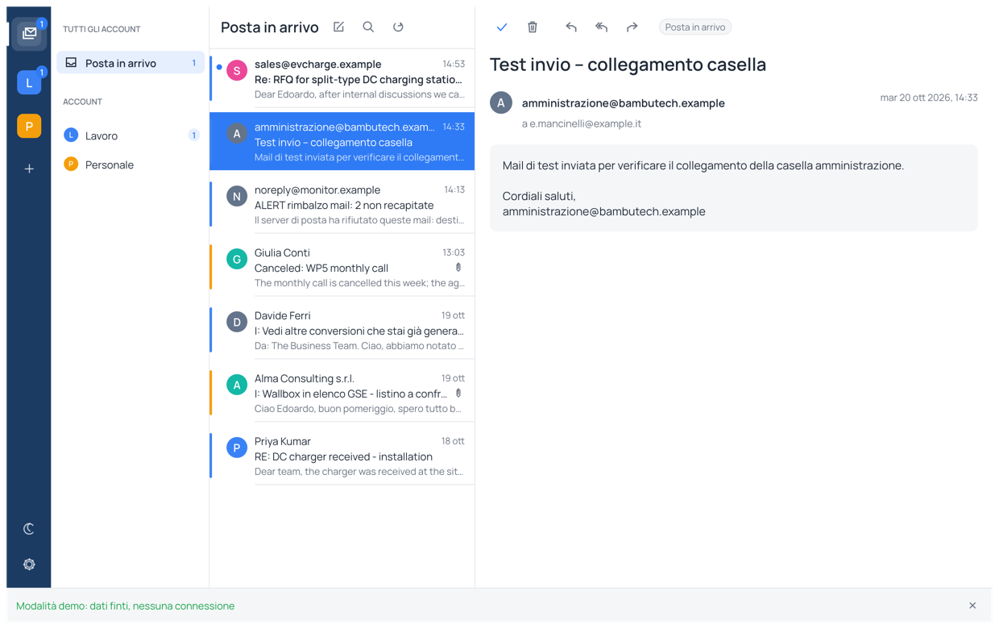
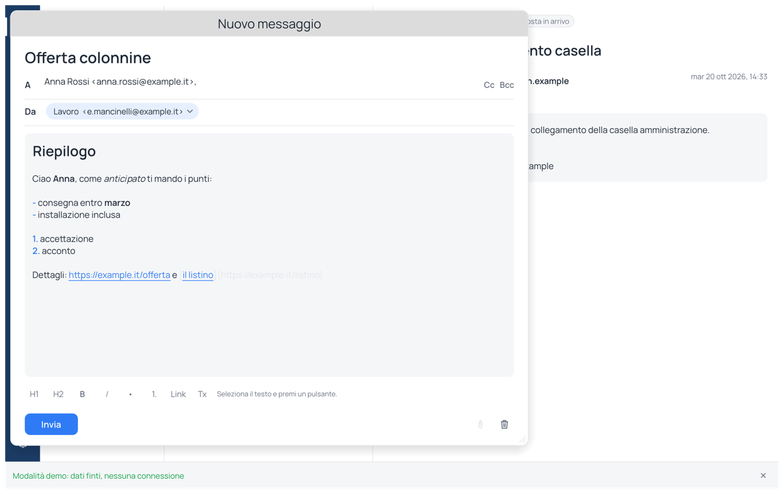
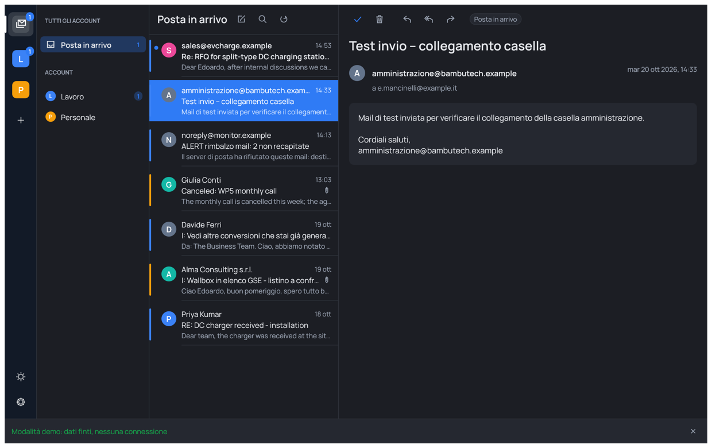

# mailopen

**A small, open-source mail client with one inbox for all your accounts. Pure Rust, no Electron.**

mailopen is a clean-room, minimal "many accounts, one window" mail client, built the way the
[ArtCraft Crafting Apps](https://github.com/storytold)
build theirs: one Rust codebase, native [egui](https://github.com/emilk/egui) on the GPU,
MIT OR Apache-2.0, nothing copied from anyone's product.

<p align="center"></p>

## What it does (v0.1)

- **Many accounts, one list.** Gmail, Outlook / Microsoft 365, iCloud, Aruba, Libero, Yahoo,
  Fastmail or any IMAP/SMTP server. "Tutta la posta" merges every inbox, newest first, with a
  colour stripe per account.
- **One window, three panes.** Dark account rail with unread badges · folders with icons and
  "Le tue cartelle" · message list with avatar, bold unread, text preview · reading pane with an
  icon toolbar. Light and dark theme, eight colour styles (general and per account), Manrope
  font (OFL, the same face as JupiterOS), every icon drawn in code.
- **Read.** Plain text as is; HTML rendered to text; attachment names listed.
- **Write.** Compose in its own window: subject on top, A with Cc/Bcc, sender chip, body with a
  formatting bar (titles, bold, italic, lists, links) that goes out as text + HTML.
  Reply, reply all, forward (text only), per-account signature as plain text or pasted HTML (sent as a text+HTML message), copy to the Sent folder.
- **Sender logos.** Gravatar for the address, then the domain's icon, cached on disk; can be
  switched off in Impostazioni (it does contact those services).
- **Address book, automatically.** Every sender and recipient that passes through is remembered
  (`contacts.toml`) and suggested while you type; Enter or Tab takes the first match.
- **Keep tidy.** Mark read/unread, delete (moved to the Trash folder), search by sender or
  subject, automatic refresh.
- **Private by construction.** Passwords live in the OS keyring (macOS Keychain, Windows
  Credential Manager, Secret Service). Config is one TOML file. No telemetry, no cloud, no
  JavaScript.

Not yet: OAuth (Gmail and Microsoft need an app password), attachments download/send, HTML
rendering, offline cache, calendar, contacts, notifications. See [ROADMAP.md](ROADMAP.md).

## Quick start

```sh
cargo run --release -p mailopen
```

The first run opens "Aggiungi account": pick the provider, type address and password, press
**Prova e aggiungi**. The login is tested over IMAP before anything is saved.

Config lives in `~/Library/Application Support/mailopen/config.toml` (macOS),
`~/.config/mailopen/` (Linux) or `%APPDATA%\mailopen\` (Windows). Set `MAILOPEN_CONFIG_DIR`
to use another folder (handy for testing).

<p align="center"> </p>

## Install on macOS

```sh
packaging/macos/build-app.sh      # builds, bundles mailopen.app with a code-drawn icon, signs, copies to /Applications
```

## Looking at the UI without a server

```sh
MAILOPEN_DEMO=1 cargo run -p mailopen                      # fake accounts and messages, no network
MAILOPEN_DEMO=1 cargo run -p mailopen --example ui_shot -- inbox /tmp/inbox.png     # offscreen PNG
MAILOPEN_DEMO=1 cargo run -p mailopen --example ui_shot -- compose /tmp/compose.png
MAILOPEN_DEMO=1 cargo run -p mailopen --example ui_shot -- account /tmp/account.png
MAILOPEN_DEMO=1 cargo run -p mailopen --example ui_shot -- dark /tmp/dark.png      # also: light, settings
```

## Architecture

| Crate | Job |
|---|---|
| `crates/core` (`mailopen-core`) | accounts and config, keyring, IMAP (rustls), SMTP (lettre), message parsing (mail-parser), one background worker thread per account. **No GUI code.** |
| `apps/mailopen` | the egui window: `ui/rail.rs` (accounts), `ui/sidebar.rs` (folders), `ui/list.rs`, `ui/reader.rs`, `ui/compose.rs`, `ui/account_dialog.rs`, `ui/icons.rs` (icons drawn in code), `ui/theme.rs`. Thin: it reads core state and sends `Request`s. Also a library, so `examples/ui_shot.rs` can render it headlessly. |

The GUI never blocks on the network: every IMAP/SMTP call runs on the account's worker thread
and comes back as an `Event` on a channel.

## Never crash

No `unwrap`, `expect`, `panic!`, indexing or `unsafe` in production code (enforced by clippy
lints in `Cargo.toml`). Hostile input (mail from the network) is parsed defensively and tested
with garbage.

## Development

```sh
cargo fmt --all
cargo clippy --workspace --all-targets   # must be clean
cargo test --workspace
```

## License

MIT OR Apache-2.0, at your option. Built from public standards (RFC 3501 IMAP, RFC 5321 SMTP,
RFC 5322/2045 messages, RFC 6154 special-use folders). No code or asset from any proprietary
mail client.
